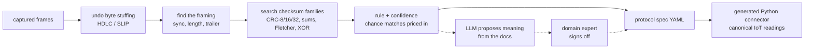

# iot-rosetta

**Infer the grammar of legacy IoT protocols from captured frames.** Not quite the universal translator, but working on it.

  

## TL;DR

**You have a device that talks, and nobody can tell you how.** No docs, no vendor, no source. iot-rosetta reads a few captured
messages and works out how they are built: where each message starts and ends, and how the device checks that it arrived
intact. That is the part that normally costs days of hex-staring.

- **Who it is for:** anyone integrating old or obscure equipment: sensors, meters, batteries, trackers, machine controllers.
- **What you give it:** a handful of captured messages, as hex. No documentation needed.
- **What you get:** the message structure and checksum rule, with an honest confidence ("high", or "low, you need more samples").
  From there it can generate a connector that turns the device's output into clean, structured data.
- **What it does not do (yet):** tell you what a number *means*. Volts or litres is a job for the manual, an LLM and someone who
  knows the equipment. That review step is the plan, not the product.
- **How far along:** early. It has been tested on 30 real protocols, from building automation to GPS trackers to batteries, and
  it gets some wrong. Those failures are listed openly.

**Try it in a minute:** `python -m reverse.cli identify --frames frames.txt` (see [Quick start](#quick-start)).
Have a device it fails on? That is the most useful thing you can send: [how to add it](#contribute-a-protocol-in-ten-minutes).

[See it work](#see-it-work) · [How it works](#how-it-works) · [30 real protocols](#tested-on-30-real-protocols) · [Known failures](#known-failures-the-corpus-is-not-a-victory-lap) · [Contribute](#contribute-a-protocol-in-ten-minutes) · [Where this is going](#where-this-is-going)

## The problem

Most of the world's IoT hardware speaks a protocol nobody wrote down: a battery on a serial line, a meter, a GPS tracker, a
sensor from a supplier that no longer exists. There is no source code to decompile and the PDF, if there is one, is wrong in
places. What you have is bytes on a wire.

Working out the *grammar* of those bytes by hand (where a frame starts, how long it is, which checksum protects it, and with
which polynomial) takes days of squinting at hex. iot-rosetta does that part: give it captured frames and it tells you the
structure and the checksum rule, **with an honest confidence**, and can generate a connector from the result.

It finds the grammar. It does not know what a field *means*; that is a job for documentation, an LLM and, above all, a person
who knows the equipment. See [Where this is going](#where-this-is-going).

## See it work

Two real frames from BACnet MS/TP (a building-automation bus), copied from public sources, no documentation given to the tool:

```
$ cat frames.txt
55 ff 05 10 00 00 06 e8 01 03 01 04 01 01 e3 99
55 ff 06 7f 02 00 1d 90

$ python -m reverse.cli identify --frames frames.txt
2 frame(s), confidence low
  mid-frame check (low): CRC-8, poly 0x81, init 0xFF, reflected, final XOR 0xFF; covers bytes from offset 2 up to the check at offset 7 (mid-frame, header is 8 bytes)
  low confidence: few frames, so rules that agree by chance cannot be ruled out. Add frames.
```

The checksum is not at the end of the frame, it protects a five-byte header, and the tool found it anyway. It says `low`
because two frames cannot rule out a coincidence, and it tells you so. With six real packets from a WHOOP strap:

```
$ python -m reverse.cli identify --frames whoop_packets.txt
6 frame(s), confidence high
  rule: CRC-32, poly 0x04C11DB7, init 0xFFFFFFFF, reflected, final XOR 0xFFFFFFFF, little-endian; covers bytes from offset 4 to the check
  1 rule(s) validate every frame
```

The page that documents that protocol gives CRC parameters that fail two of its own six packets. The tool's answer fits all six.
**Published parameters are not ground truth. The frame is.**

## How it works



Solid arrows work today. Dashed arrows are the planned review step, deliberately not built yet.

- **Confidence is arithmetic, not vibes.** It is frames x check bits, minus what the search cost in chance matches. `high` needs
  at least 40 bits, `medium` 20. One short frame is always `low`, and the output says so.
- **Every pass prices its own tries.** Hunting more kinds of check raises the odds of a coincidence on a small capture, so each
  extra pass (mid-frame checks, hidden constants, polynomial sweeps) subtracts what it cost.
- **It only learns what was validated.** Rules found by tolerant or sweeping passes are never written to the knowledge base.
- **Failures are written up, not hidden.** See [Known failures](#known-failures-the-corpus-is-not-a-victory-lap).

## Tested on 30 real protocols

Every frame in the corpus comes from a datasheet, a forum thread or a public repo, with its source link in
[`corpus/cases/`](corpus/cases). The tool is given only the frames and has to find the documented rule itself.

| Protocol | Frames | Check found blind | Confidence |
|---|---:|---|---|
| BACnet MS/TP frames | 2 | CRC-8 poly 0x81 (mid-frame): yes | low |
| Cressi Nepto dive computer | 2 | CRC-16 poly 0x1021: yes | medium |
| CRSF | 1 | CRC-8 poly 0xD5: yes | low |
| Daly smart BMS | 14 | 8-bit sum: yes | high |
| Davis Vantage console CRC | 1 | CRC-16 poly 0x1021: yes | low |
| DNP3 link-layer headers | 12 | CRC-16 poly 0x3D65: yes | high |
| ROBOTIS Dynamixel Protocol 2.0 | 24 | CRC-16 poly 0x8005: yes | high |
| JBD / Xiaoxiang smart BMS | 18 | negated 16-bit sum: yes | high |
| MAVLink v1 HEARTBEAT | 1 | CRC-16 poly 0x1021 (seeded): yes | low |
| Wired M-Bus long frames | 10 | 8-bit sum: yes | high |
| Modbus ASCII | 15 | negated 8-bit sum: yes | medium |
| Modbus RTU frames | 14 | CRC-16 poly 0x8005: yes | high |
| 1-Wire DS18B20 scratchpad reads | 5 | CRC-8 poly 0x31: yes | high |
| 1-Wire 64-bit ROM codes | 2 | CRC-8 poly 0x31: yes | low |
| PACE RS232 BMS | 1 | sum over ASCII text, negated: yes | low |
| Plantower PMS3003/PMS5003 particulate sensor | 3 | 16-bit sum: yes | high |
| Plantower PMS5003 host commands and passive-mode reply | 6 | 16-bit sum: yes | high |
| PPP in HDLC-like framing | 2 | CRC-16 poly 0x1021: yes | medium |
| Sensirion I2C data words | 9 | CRC-8 poly 0x31: yes | high |
| Sensirion SHDLC | 3 | 8-bit sum: yes | medium |
| Seplos BMS RS485 | 1 | sum over ASCII text, no +1: yes | low |
| Teltonika Codec 8 AVL data packets | 2 | CRC-16 poly 0x8005 (zero-padded field): yes | medium |
| Tuya Wi-Fi module <-> MCU serial protocol | 10 | 8-bit sum: yes | high |
| u-blox UBX | 1 | Fletcher-8: yes | low |
| u-blox UBX frames from pyubx2 tests | 3 | Fletcher-8: yes | high |
| Victron VE.Direct HEX commands | 4 | negated 8-bit sum: yes | medium |
| Victron VE.Direct text-mode block | 1 | negated 8-bit sum: yes | low |
| WHOOP strap BLE packets | 6 | CRC-32 poly 0x04C11DB7: yes | high |
| Winsen ZH06 / MH-Z19-style gas & dust sensors | 3 | negated 8-bit sum: yes | medium |
| Digi XBee API frame | 1 | 8-bit sum: yes | low |

*Regenerate with `python scripts/run_corpus.py --markdown`.* Read it with the caveats in the sections below in mind: one or two
frames cannot separate rules that agree by chance, and the Modbus RTU frames were filtered with the known CRC, so that row shows
agreement rather than blind discovery.

## Quick start

```
git clone https://github.com/MartinTheGuitarMan/iot-rosetta
cd iot-rosetta
pip install -r requirements.txt

python scripts/run_corpus.py                                  # score the tool against all 30 real cases
python -m reverse.cli identify --frames frames.txt            # one hex frame per line
PYTHONPATH=. python -m pytest -q                              # tests (two modules need influxdb_client)
```

Frame files take one hex frame per line, spaces allowed. Lines starting with `:` (hex text, as Victron and Modbus ASCII use) and
NMEA `$..*hh` sentences are recognised too.

## Contribute a protocol in ten minutes

The most useful contribution is a real protocol the tool gets wrong. A case is one YAML file: a few real frames, a source link
and the rule the vendor documents. Copy [`corpus/CASE_TEMPLATE.yaml`](corpus/CASE_TEMPLATE.yaml), run
`python scripts/run_corpus.py`, and see whether the tool agrees. If it does not, that is the best kind of pull request.
Details in [CONTRIBUTING.md](CONTRIBUTING.md). If you have a Seplos or Pylontech battery, there is a specific open question in
[`corpus/cases/seplos_pylon_command.yaml`](corpus/cases/seplos_pylon_command.yaml).

## Where this is going

The long-term picture is a "universal translator" for IoT, in three roles:

1. **The tool infers the grammar** from captured frames (this repository, today).
2. **An LLM proposes what the fields mean** from whatever documentation exists.
3. **A domain expert gates it.** Nothing becomes a connector until someone who has stood next to the equipment says yes.

Step 3 is the point, not a formality: the tool is routinely right about a number and silent about whether it is volts or
litres. An open, growing collection of verified cases is the part that can be shared today, and it is the
[corpus](corpus/cases).

## Under the hood: capture → spec

Stage 2 below starts from *documentation*. This is the other starting point: no
documentation at all, just a captured byte stream and a few readings a human noted
off the device's own display.

```
reverse/infer.py            stage 1: frame structure from the bytes alone (sync, length
                            field or constant size, trailer, checksum family + parameters,
                            sequence counter, type byte, payload size)
                            stage 2: fit every (offset, width, endianness, signedness)
                            candidate to the anchors: value = raw * scale + bias
reverse/knowledge.py        what earlier validated runs learned (see below)
reverse/cli.py              python -m reverse.cli infer | learn | knowledge
scripts/gen_legacy_demo.py  simulates an unknown device with a HIDDEN protocol and writes
                            capture.bin + anchors.yaml + truth.csv (4 profiles, below)
tests/test_framed_binary.py end-to-end: infer from capture+anchors only, generate connectors,
                            score every decoded value against truth.csv
```

Inferred specs go through the same `ProtocolSpec` loader and codegen as hand-written
ones (`specs/vessel_legacy_*.yaml` → `connectors/vessel_legacy_*.py` are checked-in
output of the demo). Anchors look like
`{message: engine, field: rpm, unit: rpm, ordinal: 120, value: 1480}`, where `ordinal`
is the frame's (unwrapped) sequence counter, or its index among the valid frames when
the protocol has none.

The simulated devices are modelled on shapes that real devices have and that broke the
first version of the tool:

| profile | shape |
|---|---|
| `vessel` | sync `7E C3`, length byte, type byte, sequence counter, CRC-16/MODBUS |
| `vessel_oddcrc` | the same layout with an obscure CRC polynomial (in no catalogue) |
| `cressi` | 3-byte sync, length, command, CRC-16/XMODEM, then a constant end byte; no sequence counter |
| `apc` | constant 19-byte frames: **no sync, no length, no type byte**, Fletcher-8 check (not a CRC) |

### It gets smarter with use

`reverse/knowledge.json` (plain JSON, meant to be read and diffed) records what *validated*
runs established, and later runs use it:

- **checksums** — exact parameter sets that validated real frames are tried first, and
  their polynomials extend the built-in catalogue. A device with an unusual CRC only has
  to be identified once.
- **framings** — a capture that fits a known layout is recognised immediately, without
  the heuristics.
- **encodings** — when the anchors cannot tell two encodings apart (int8 vs uint8 when a
  temperature never went below zero), the encoding seen for that unit in more distinct
  protocols breaks the tie.

```
python -m reverse.cli infer ...              # records the run if it validated
python -m reverse.cli learn --spec s.yaml --capture c.bin   # teach it a device it cannot work out
python -m reverse.cli knowledge              # what has it learned so far
```

Rules that keep it honest:

- Only validated runs teach anything: a checksum must have matched the real frames and
  every anchor must have fitted. `learn` refuses a spec whose generated connector does
  not explain the capture (>= 20 frames, >= 90% of the bytes).
- A guess is never recorded as evidence. A prior can only choose between representations
  of the same bytes at the same offset and scale (signedness, width), never override what
  the anchors show, and a fit that needed a tie-break is not written back, otherwise the
  knowledge base would reinforce its own habits (there is a regression test for exactly
  that bug).
- Evidence is counted per distinct protocol, not per run.

What this does and doesn't show:

- The inference never sees the device's spec; the truth is only used to score. That
  avoids the circularity noted above ("generated from the connectors' own assumptions").
- Ambiguity is resolved by the data, not guessed, and reported when it remains: sub-zero
  anchors force `int8`, anchors spanning a low-byte rollover fix a counter's byte order.
  A field whose high byte is always zero reads equally well as `uint8` or `uint16_le`;
  the narrower one is chosen. Choose anchors that span the range.
- Still easy mode: no encryption, no bit-packed fields, no multi-frame messages, frames at most ~128 bytes for the no-sync
  case, and a type byte in a constant-size stream must switch value often (interleaved
  messages) to be told apart from a slowly drifting sensor.
- Deterministic heuristics plus the knowledge base, no LLM. Only two frames of real
  hardware (the Cressi write-up) have been run through this; real captures are the actual test.

## The corpus: real published frames

The table at the top lists every case. This section is the detail behind it. Each `corpus/cases/*.yaml` holds real frames
transcribed from datasheets, forum threads and public repos, with the source and the rule the vendor documents.
`scripts/run_corpus.py` identifies the rule blind and scores it:

```
python scripts/run_corpus.py
python -m reverse.cli identify --frames frames.txt     # one hex frame per line; ':7A8ED00B9' and '$..*hh' lines work too
```

Currently 30 of 30 cases find the documented rule (Modbus RTU, DNP3, UBX, Tuya, Plantower, Daly, JBD, Sensirion
SHDLC and I2C words, XBee, Winsen, Cressi, Victron VE.Direct HEX, wired M-Bus, 1-Wire DS18B20, WHOOP, PPP/HDLC, the Davis console CRC, Modbus ASCII, MAVLink, Dynamixel 2.0, CRSF, BACnet MS/TP, VE.Direct text, Seplos and PACE YD/T 1363 style, Teltonika Codec 8);
13 of them with high confidence. Checksum families: CRC-8/16/32 (poly, init, reflection, final XOR, byte order),
Fletcher, 8/16-bit sums and negated sums, XOR. Byte-stuffed frames (HDLC/PPP 7E/7D, SLIP) are unstuffed first,
but only when every frame starts and ends with the same flag byte (`reverse/stuffing.py`). Also covered: SeaTalk 1's low-nibble length rule
(no checksum), NMEA 2000 fast-packet detection on a real vessel capture (`reverse/canlog.py`), a blind locator for
known readings (`reverse/locate.py`: LE/BE/signed integers, packed BCD, float32, power-of-ten scales), and
per-block CRCs (DNP3: a CRC after every 16 data bytes).

The WHOOP case is a useful warning: the page documenting it gives CRC parameters that fail two of its own six
packets, while the blind result (plain CRC-32 over the payload from byte 4) fits all six. Published parameters
are not ground truth.

When no rule fits every frame (a real capture has corrupted ones), `identify` falls back to the rule that fits at
least 70% of at least 5 frames, names the outliers, caps confidence at medium and never learns from it. The
Modbus ASCII case uses this: 11 of the 15 pymodbus test frames fit the spec LRC, the other four are odd fixtures.

Seeded CRCs (MAVLink's CRC_EXTRA: a constant byte, different per message type, appended to the data before the CRC
but never sent) are solved, not enumerated: `identify()['seeded_crc16']` lists the CRC-16 parameters and the solved byte,
per message type when the frames can be grouped by a header byte and every group has at least two frames. One real
HEARTBEAT frame gives the right rule plus a chance candidate, at low confidence.

Nested checks (CRSF: a CRC-8 sits inside the data a second CRC-8 covers) are searched one level deep. When nothing
fits, a full CRC-8 polynomial sweep runs, but only with at least 3 frames and with its extra chance matches priced
into the confidence. The real CRSF frame in the corpus is a single frame, so its inner CRC (poly 0xBA, not a built-in)
is NOT found; the synthetic test shows the same rule is found once there are 4 frames.

A check can also sit mid-frame (BACnet MS/TP: a CRC-8 over the 5-byte header, then payload, then a CRC-16). The header-check
pass tries every prefix length from 3 to 14 bytes as if it were a frame with a trailing check, needs at least 2 frames, and
subtracts log2(prefix lengths x candidates tried) from the confidence. With two real MS/TP frames it finds the header CRC-8
(poly 0x81, init FF, complemented) at low confidence. The payload CRC-16 after a variable-length payload is not located yet.

Text frames whose checksum is itself written as hex text and computed over the ASCII characters (the Pylontech/Seplos/PACE
family: '~' + hex text + 4 hex digits + CR) get their own pass: start offset 0-2, 2 or 4 digits, and sum / negated sum /
inverted sum are tried. Two real documents disagree on the convention (+1 or not), and the vendor's own prose disagrees
with its own example frame, so the tool reports what the frame satisfies, not what the manual says.

A check stored zero-extended in a wider field (Teltonika Codec 8: CRC-16 in a 4-byte slot, 00 00 + CRC) is handled by removing
the pad bytes and searching again; it needs at least 2 frames with the same pad.

Be careful with the numbers: one or two frames cannot separate rules that agree by chance (the output says
`confidence: low`), a constant solved from the data (Victron's 0x55) counts as a free parameter, and the Modbus case
was filtered with the known CRC, so it shows agreement rather than blind discovery. Real captures (`libmbus`,
`n2k`) are cloned by the tests that use them and skipped when absent. libmbus telegrams embedded here are
BSD-3-Clause, Copyright (c) 2010-2012 Raditex Control AB.

### Known failures (the corpus is not a victory lap)

- CRSF: the inner CRC-8 (poly 0xBA) is not found from one frame; the poly sweep needs at least 3.
- Dynamixel 2.0: the insertion-style byte stuffing is not handled (the 24 corpus packets contain none).
- Davis: only a short frame is in the corpus; the full LOOP packet is missing.
- BACnet MS/TP: the payload CRC-16 after a variable-length payload is not located, only the header CRC-8.
- Teltonika: the 4-byte data length field is not found (length search covers 1-2 byte fields).
- One or two tiny frames always give chance candidates; the tool says `low` and lists them.
- Published parameters can be wrong (WHOOP, the Seplos manual's prose): the frame wins over the page.
- Unknown 16/32-bit polynomials cannot be recovered; only an 8-bit polynomial sweep exists.
- No real vessel captures yet (Simrad, Kongsberg, TSS1) and no hardware in the loop.

### What identify() returns, beyond `matches`

`partial` (tolerant pass, outliers named), `seeded_crc16`, `nested`, `poly_sweep`, `header_checks` (mid-frame),
`ascii_hex_checks` (hex-text checksums over ASCII), `padded_check` (zero-extended field), `stuffing`, `confidence`.
Each pass runs only when the earlier ones leave the answer open, and each prices its own extra tries into `confidence`.

Not yet: code generation for text-wrapped frames, byte-stuffed frames, seeded and nested CRCs, header, ASCII-hex and padded
checks, per-block CRCs and CAN; the locator finds candidates but does not yet choose between them from a single frame.

---

## Background: the connector generator

Experiment: can an LLM be used to build Python connectors for IoT device
protocols that translate into a canonical IoT structure?

The example domain is multi-vendor weather station telemetry, picked
deliberately: unlike something like Modbus-over-industrial-PLC, where the
transport is already a mature, decades-solved problem, weather sensor
hardware has no real standard. Every vendor's ASCII sentence dialect (or,
for some stations, Modbus register map) differs, and unifying them into
one schema is still mostly hand-coded, per-integration work — which is
exactly the kind of fragmentation this generator is meant to paper over.

### Stage 1: template-based connector generator

Rather than hand-writing (or LLM-writing) each protocol connector directly,
this stage builds the **generator** first: a small deterministic tool that
turns a declarative protocol spec (YAML) into a standalone Python connector
module, so the connector-writing knowledge lives in the spec + codegen
backend, not in one-off hand-written parsers.

```
canonical.py            canonical IoT reading shape every connector targets
generator/spec.py       ProtocolSpec model (loads + validates YAML specs)
generator/codegen.py    renders a ProtocolSpec into connector source
generator/cli.py        `python -m generator.cli generate --spec ... --out ...`
specs/                  example protocol specs
connectors/             generated connector modules (checked in, regeneratable)
scripts/                sample data generator
sample_data/            synthetic telemetry capture (generated, checked in)
pipeline/                CanonicalReading -> InfluxDB point mapping + runner
nodered/                Node-RED flow: alternative ingest path, same canonical contract
grafana/provisioning/   auto-provisioned InfluxDB datasource + dashboard
docker-compose.yml      local InfluxDB + Grafana + Node-RED stack
tests/                  generator, connector, pipeline, and sample-data tests
```

Three transports are implemented. None is tied to any one protocol
standard or vendor — they're general field-addressing strategies that
cover most real device wire formats:

- **delimited_text** — comma-delimited, field-index addressed (the kind
  of ASCII sentence a lot of serial sensor hardware emits).
  - `specs/weather_station_obs.yaml` → `connectors/weather_station_obs.py`:
    parses `$..WXOBS` sentences (checksum-verified) into site position,
    temperature, humidity, and pressure. Timestamp comes from an external
    `reference_date` parameter, since the sentence carries only time-of-day
    (`hms_time` field type).
  - `specs/weather_station_obs_full.yaml` → `connectors/weather_station_obs_full.py`:
    parses `$..WXOBSF` sentences into position and wind speed/direction.
    Unlike the plain reading, this one carries its own `ddmmyy` date field
    (`canonical.date_field` in the spec, `ddmmyy_date` field type), so its
    timestamp is self-contained and its `parse()` takes no `reference_date`.
    A 2-digit year is inherently ambiguous across centuries — the generator
    resolves it to 2000-2099, documented (and tested) as a known limitation
    of that date encoding, not a parsing bug.
- **register_map** — address/scale addressed (Modbus-style). Example:
  `specs/weather_station_modbus.yaml` → `connectors/weather_station_modbus.py`:
  a *different vendor's* weather station, exposed over Modbus holding
  registers instead of ASCII sentences (rainfall, wind gust, battery
  voltage, UV index) — the same real-world fragmentation story, a second
  wire format for the same category of device.

- **framed_binary** — a byte stream of self-delimiting frames, fields addressed by
  byte offset (`uint8`/`int16_le`/`uint32_be`/..., `scale`, `bias`). The shape of many
  legacy serial/RS-485 device protocols. A frame is delimited by a length byte *or* a
  constant `fixed_length`; may start with `sync` bytes (or have none, then the stream
  re-synchronises on the check value); may have a message-type byte (or be
  single-message); carries a check value (`crc16` with any polynomial/init/reflection,
  `fletcher8`, `sum8`, `xor8`) and optionally constant `trailer` bytes after it.
  Generated modules expose `iter_frames(stream)` (resyncs after noise, drops corrupt
  frames) and `parse(frame, device_id, timestamp)`; the wire has no clock, so the caller
  supplies the timestamp. `specs/cressi_nepto_identity.yaml` is a real device (a dive
  computer) written from frames published in a reverse-engineering write-up, checked
  in tests against those exact bytes. See "Reverse: capture → spec" below.

Every generated connector's `parse(...)` returns a `canonical.CanonicalReading`
(device_id, protocol, message_type, ISO 8601 timestamp, location, a list of
named/unit-tagged measurements, and the original raw field values) —
one shape regardless of source protocol or vendor.

Regenerate a connector after editing its spec:

```
pip install -r requirements.txt
python -m generator.cli generate --spec specs/weather_station_obs.yaml --out connectors/weather_station_obs.py
python -m pytest -q
```

Generated modules are self-contained: they import only `canonical` and the
stdlib, so they can be committed and shipped without depending on
`generator/` or PyYAML at runtime.

### Why generator-first

The generator is a deterministic backbone, testable independent of any LLM
call: given a spec, the output is byte-for-byte reproducible (verified —
regenerating a connector produces an identical file). That gives a stable
target for the next stage to build against, and a way to tell "the LLM got
the mapping wrong" apart from "the codegen is non-deterministic/buggy."

### Sample data

`scripts/generate_sample_data.py` generates a synthetic but plausible
telemetry capture: one fixed weather station site emitting paired ASCII
observation sentences, plus a second vendor's station at the same site
reporting over Modbus. It's seeded (deterministic, reproducible) and writes:

```
sample_data/weather_obs_log.txt           60 sentences (30 WXOBS + 30 WXOBSF)
sample_data/weather_station_modbus.jsonl  30 register snapshots
```

This is fixture data for exercising the pipeline end-to-end — it is
generated *from* the connectors' own spec assumptions, so it proves the
generator is internally consistent, not that real hardware matches those
assumptions. See "What's actually verified" below.

### Pipeline: connectors → canonical → InfluxDB

```
pipeline/influx_sink.py    CanonicalReading -> influxdb_client.Point
pipeline/run_pipeline.py   reads sample_data/, runs it through the
                            connectors, writes points to InfluxDB
```

All readings share one InfluxDB measurement, `iot_reading`; protocol
and message type are tags, not the measurement name, so a single query can
span every protocol/vendor for a device.

```
# Print line-protocol output, no InfluxDB required:
python -m pipeline.run_pipeline --dry-run

# Write to a real InfluxDB (see the docker-compose stack below):
INFLUX_TOKEN=devtoken-not-a-secret python -m pipeline.run_pipeline
```

### Local test environment: InfluxDB + Grafana + Node-RED

```
docker compose up -d
```

- **InfluxDB** (`localhost:8086`) — org `iot`, bucket `telemetry`,
  admin token `devtoken-not-a-secret` (a local-dev placeholder baked into
  `docker-compose.yml` and `grafana/provisioning/datasources/influxdb.yaml`
  — not meant to be a real secret; change it if this ever runs anywhere
  beyond your own machine).
- **Grafana** (`localhost:3000`, anonymous viewer access enabled) —
  auto-provisioned with the InfluxDB datasource and an "IoT Telemetry
  Overview" dashboard (temperature, humidity, wind speed, rainfall from
  the second vendor's Modbus station, latest observation).
- **Node-RED** (`localhost:1880`) — an alternative ingest path to
  `pipeline/run_pipeline.py`: `POST /ingest/reading` with a
  `CanonicalReading.to_dict()`-shaped JSON body, and its one function node
  converts it to InfluxDB line protocol and writes it, exactly like
  `pipeline/influx_sink.py` does in Python. This demonstrates the canonical
  schema working as a real cross-language contract, not just a Python-internal
  convenience. Try it once the stack is up:

  ```
  curl -X POST http://localhost:1880/ingest/reading \
    -H 'Content-Type: application/json' \
    -d '{"device_id":"site-1","protocol":"wx_ascii","message_type":"WXOBS",
         "timestamp":"2026-09-21T12:35:19Z",
         "measurements":[{"name":"temperature_c","value":23.5,"unit":"celsius"}],
         "location":{"lat":48.1173,"lon":11.5167}}'
  ```

Then load the sample data into InfluxDB and open Grafana:

```
INFLUX_TOKEN=devtoken-not-a-secret python -m pipeline.run_pipeline
open http://localhost:3000   # dashboard: IoT Telemetry Overview
```

### What's actually verified, and what isn't

This sandbox can run the Docker CLI and daemon, but its network policy
blocks pulls from Docker Hub's image CDN (`production.cloudfront.docker.com`
returns 403 from the proxy) — confirmed, not assumed. So none of this stack
has been visually confirmed running end-to-end here. What *was* verified
in this environment, without a live container:

- `docker compose config` resolves the compose file cleanly (services,
  volumes, `depends_on`, port mappings all structurally valid).
- `grafana/provisioning/**/*.{yaml,json}` all parse as valid YAML/JSON —
  the dashboard JSON was hand-authored, not exported from a running
  Grafana, so treat it as a good-faith starting point rather than a
  guaranteed-perfect import; it may need minor adjustment on first load.
- The Node-RED flow's logic doesn't need Node-RED to check: the exact
  `func` string is extracted straight out of `nodered/flows.json` and
  executed under plain Node.js in `tests/test_nodered_flow.js`, asserting
  it produces the same line protocol as `pipeline/influx_sink.py`'s Python
  implementation for the same input, including the edge case (a reading
  with nothing to write). Run it with `node tests/test_nodered_flow.js`.
- The Python side of the pipeline (sample data → connectors → canonical →
  `Point.to_line_protocol()`) is fully covered by `pytest` without a live
  InfluxDB — `Point` serialization is pure and needs no network connection.

The images are official multi-arch builds (`influxdb:2`, `grafana/grafana`,
`nodered/node-red`) and should pull and run natively on Apple Silicon.
Once it's up on your machine, the honest verification loop is: confirm
`docker compose ps` shows all three healthy, run the pipeline, open
Grafana and see the panels populate, and try the `curl` above against
Node-RED and confirm the point shows up in Grafana too.

### Stage 2 (planned, not yet built): LLM-assisted spec/connector authoring

Have an LLM draft the declarative spec (or the connector directly) from raw,
unstructured protocol documentation — a sensor's ASCII sentence table, a
vendor's Modbus register map datasheet — instead of a human writing YAML by
hand. This is the part that actually tests the "can an LLM build IoT device
connectors" question; stage 1 is the harness it will be evaluated against
(does the generated spec validate, does the generated connector's test
output match real captured device data).
